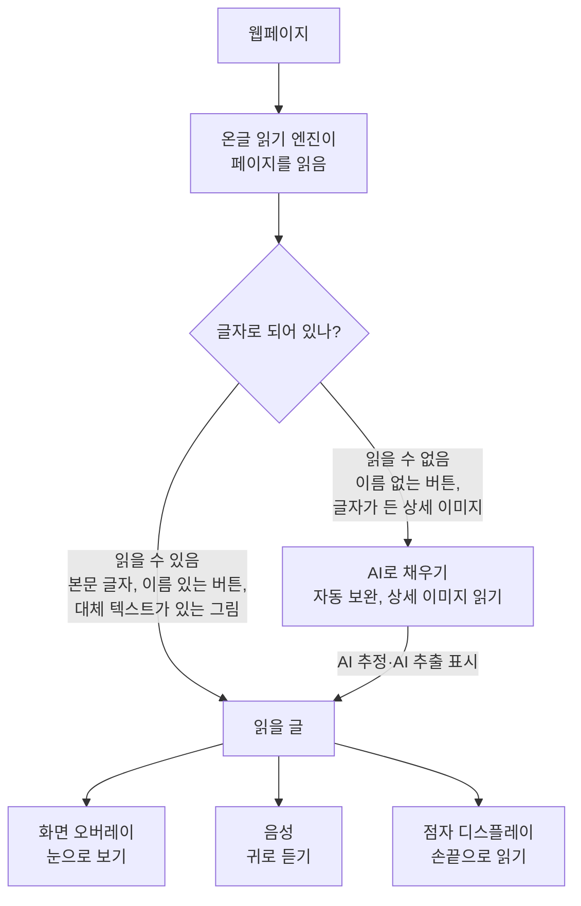

<p align="center"></p>

# 온글
AI를 결합한 웹 스크린리더 (크롬 확장 프로그램)

온글은 "온전한 글"이라는 뜻입니다. 프로젝트(저장소) 이름은 SSUcreamMaker(숭실대에서 스크린리더 도구를 만든다는 뜻)이고, 사용자에게 보이는 확장 이름이 온글입니다.

온글은 웹페이지를 직접 읽어 주는 **스크린리더**입니다. 읽은 내용을 화면 위에 글로 띄우고(화면 오버레이), 소리로 읽고(브라우저 음성), 점자 디스플레이로 보냅니다. 여기에 AI를 더해 기존 스크린리더가 못 읽는 버튼·그림 속 글자를 채워 읽고, 긴 페이지를 요약하고, 원하는 정보를 물으면 바로 답합니다.

설치형 프로그램 대신 크롬 확장으로 만든 이유는 시각장애인에게 프로그램 설치 단계 하나가 큰 장벽이기 때문입니다. 브라우저에 추가만 하면 됩니다.

> **개발 중**: 스크린리더 기본 기능(읽기, 이동, 화면 자막, 음성, 온글 메뉴), 점자 출력, AI 기능을 만들었고, 지금은 실제 AI 평가와 Windows 확인을 하고 있습니다. 진행 단계는 [docs/PROPOSAL.md](docs/PROPOSAL.md) 10장을 참고하세요.

| 출력 | 내용 |
|---|---|
| 화면 오버레이 | 지금 읽는 글을 화면 위 자막 패널로 보여 주고, 읽는 위치에 테두리를 표시 (macOS VoiceOver 자막 패널 방식) |
| 음성 | 같은 글을 크롬 확장 음성(`chrome.tts`)으로 읽음. 운영체제의 한국어 음성 사용 |
| 점자 디스플레이 | 같은 글을 한국 점자로 바꿔 점자 디스플레이로 보냄. 이 프로젝트는 실제 기기 대신 **가상 점자 디스플레이**로 구현하고, 관리자용 "점자 전달 테스트" 버튼으로 전달 결과를 확인 |

| AI 기능 | 내용 |
|---|---|
| 자동 보완 | 이름 없는 버튼·그림을 읽을 때 AI가 무엇인지 설명을 붙여 읽음 ("AI 추정") |
| 상세 이미지 읽기 | 쇼핑몰 상세 이미지 속 글자를 읽어 항목별 글로 정리 |
| 페이지 요약 | 긴 페이지를 핵심 3~7항목으로 요약, 항목에서 원문 위치로 이동 |
| 질문 응답 | "배송비 얼마야?"처럼 물으면 페이지 내용만 근거로 답하고 근거 위치로 이동 |

조작은 국내 사용자에게 익숙한 NVDA·센스리더 방식을 따릅니다.

## 스크린리더 사용자는 웹을 어떻게 쓰나요?


시각장애인은 화면을 보는 대신 **스크린리더**(센스리더, NVDA, JAWS 등)를 씁니다. 스크린리더는 웹페이지의 글자와 구조(제목, 링크, 버튼, 표)를 읽어 두 가지로 전해 줍니다.

- **음성**: 글자를 소리로 읽어 줍니다. 마우스 대신 키보드로 제목, 링크, 표 단위로 건너뛰며 원하는 곳을 찾습니다.
- **점자 디스플레이**: 키보드 앞에 두는 기기입니다. 작은 핀이 올라와 점자를 만들고, 한 줄(보통 40칸 안팎)씩 손끝으로 읽습니다. 다 읽으면 버튼으로 다음 줄로 넘깁니다.


**시청각장애인**(보는 것과 듣는 것이 모두 어려운 사람)에게는 음성이 들리지 않으므로 점자 디스플레이가 웹을 읽는 유일한 통로입니다. 그래서 이 확장은 잠깐 소리로 알리고 사라지는 안내 대신, 결과와 오류를 페이지 안에 글로 남겨 점자로 언제든 다시 읽을 수 있게 합니다.

> 위 두 그림은 이해를 돕기 위해 AI(Codex)로 만든 예시입니다. 실제 기기의 모양과 점자 무늬는 다를 수 있습니다.

### 스크린리더가 읽지 못하는 것

스크린리더는 글자만 읽을 수 있습니다. 쇼핑몰 상세페이지처럼 가격, 옵션, 주의사항을 그림 속 글자로 넣고 대체 텍스트(그림 설명)를 달지 않으면, 일반 스크린리더는 "그래픽"이라고만 읽거나 아예 건너뜁니다. 이름 없는 아이콘 버튼은 "버튼"이라고만 읽습니다. 온글은 이런 부분을 AI로 읽어 채운 뒤 화면 오버레이, 음성, 점자로 전합니다.



세 출력(화면 오버레이, 음성, 점자)은 항상 같은 글에서 나옵니다. 점자 디스플레이 종류별 연결 설계는 [docs/BRAILLE-DEVICES.md](docs/BRAILLE-DEVICES.md)에 정리했습니다.

| 같은 상세 이미지에서 | 읽는 것 |
|---|---|
| 일반 스크린리더 | "그래픽" (또는 아무것도 읽지 않음) |
| 온글 (`Alt+Shift+D`) | 예: "상세 이미지 내용, AI 추출, 제목 2" → "가격·할인, 제목 3" → "할인가 24,900원 (22% 할인)" … (평가용 쇼핑몰 기준, 문장은 AI 결과에 따라 다름) |

### 참고 영상

시청각장애인이 점자정보단말기(점자 디스플레이)로 실제로 소통하는 모습을 볼 수 있는 영상입니다.

| 영상 | 내용 |
|---|---|
| [](https://www.youtube.com/watch?v=jExIQsDwt_s) | [[이런뉴스] "빛도, 소리도 차단된 사람들" 시청각장애인을 아십니까](https://www.youtube.com/watch?v=jExIQsDwt_s)<br/>KBS News, 2025년 6월, 6분 52초<br/>국회에서 시청각장애인이 점자정보단말기를 손으로 읽으며 발언하고, 다른 시청각장애인들은 손을 맞잡는 촉수화로 내용을 전달받음 |
| [](https://www.youtube.com/watch?v=IRJ4dteEp40) | [[CBS 뉴스] '점자정보 단말기'…높은 가격에 고통 받는 시청각장애인들](https://www.youtube.com/watch?v=IRJ4dteEp40)<br/>CBS크리스천노컷뉴스, 2021년 10월, 3분 27초<br/>시청각장애인이 점자정보단말기로 카카오톡을 주고받고 뉴스를 보는 모습과 기기 가격 부담 문제 |
| [](https://www.youtube.com/watch?v=f1RQcWaw7Zg) | [Meet The First Deaf-Blind Harvard Law Grad, Haben Girma](https://www.youtube.com/watch?v=f1RQcWaw7Zg) (영어)<br/>Oxygen, 2016년 10월, 4분 37초<br/>하버드 로스쿨 첫 시청각장애인 졸업생의 일상. 상대가 키보드로 치면 점자 디스플레이로 읽고 말로 답하는 장면 |

## 설치

1. [Releases](https://github.com/SSUmart/SSUcreamMaker/releases)에서 `ongeul-v<버전>.zip` (26.1.0까지는 `ssucreammaker-v<버전>.zip`)을 받아 압축 풀기 (소스로 설치할 때는 저장소의 `extension` 폴더)
2. Chrome, Edge, Whale에서 `chrome://extensions` 열기 (Edge는 `edge://extensions`)
3. 개발자 모드 켜기
4. "압축해제된 확장 프로그램을 로드합니다"에서 압축을 푼 폴더 선택
5. 설치되면 설정 화면이 자동으로 열립니다.

새 버전으로 바꿀 때는 기존 폴더를 새 버전 파일로 덮어쓴 뒤 `chrome://extensions`에서 새로고침하면 설정(API 키 포함)이 유지됩니다. 다른 폴더에 풀어 로드하거나 확장을 삭제하고 다시 설치하면 새 확장으로 인식되어 설정이 지워집니다.

## 설정

1. "AI 기능 켜기" 체크
2. AI 공급자 선택
   - Google Gemini: [Google AI Studio](https://aistudio.google.com/)에서 API 키 발급
   - NVIDIA NIM: [build.nvidia.com](https://build.nvidia.com/)에서 API 키 발급. NIM은 기본 모델이 없으니 "모델" 목록에서 추천 후보를 고르거나 "직접 입력"으로 모델 이름을 넣습니다. 직접 설치한 NIM을 쓰면 API 주소 변경. NVIDIA 무료 키는 개발·테스트 용도로만 쓸 수 있습니다.
3. API 키 입력 후 "저장", "연결 확인"으로 키 확인

- API 키는 이 브라우저에만 저장되며 동기화되지 않습니다.
- AI를 켜면 단축키를 누를 때(항목 설명 모드에서는 항목을 클릭할 때) 상세 이미지, 페이지 글, 고른 항목의 글자·그림이 선택한 AI 서비스로 전송되고, 요금은 입력한 키의 계정에 청구됩니다. 입력창에 적은 내용과 링크 주소의 쿼리는 보내지 않습니다.
- Gemini 무료 등급은 보낸 내용이 Google의 서비스 개선에 쓰일 수 있으니 개인정보가 있는 페이지에서는 쓰지 마세요.

## 사용

### 온글 스크린리더

온글을 쓰는 동안 NVDA나 센스리더 같은 다른 스크린리더는 꺼 주세요.

온글의 명령은 모두 **`Alt+Shift`**(macOS는 `Option+Shift`)와 글자 키를 함께 누릅니다. 안내·도움말·메뉴도 "Alt와 Shift와 S"처럼 지금 설정된 실제 키 이름으로 알려 줍니다.

| 크롬 단축키 (주소창 등 어디서든) | 기능 |
|---|---|
| `Alt+Shift+O` | 온글 켜기/끄기 |
| `Alt+Shift+M` | 온글 메뉴: 모든 기능을 목록에서 골라 실행 |
| `Alt+Shift+X` | 읽기 멈춤 |
| `Alt+Shift+R` | 현재 위치 다시 읽기 |

| 키 (웹페이지 안) | 기능 |
|---|---|
| `↓` / `↑` | 다음 / 이전 항목 |
| `Ctrl+Home` / `Ctrl+End` | 페이지 처음 / 끝 |
| `H` `K` `B` `F` `E` `X` `R` `C` `T` `L` `G` `D` | 제목, 링크, 버튼, 입력 요소, 편집창, 체크박스, 라디오 버튼, 콤보 상자, 표, 목록, 그래픽, 영역으로 이동 (`Shift`를 함께 누르면 위쪽으로). 한글 입력 상태에서도 동작 |
| `1`~`6` | 그 수준의 제목으로 이동 |
| `Enter` / `Space` | 누르기. 편집창에서는 글쓰기 모드(`Esc`로 읽기 모드로 돌아옴) |
| `Ctrl` | 읽기 멈춤 |
| `Alt+Shift+↓` 또는 `Alt+Shift+A` | 지금 위치부터 끝까지 계속 읽기 |
| `Alt+Shift+Space` | 읽기 모드와 글쓰기 모드 전환 |
| `Alt+Shift+S` / `Q` / `D` | 페이지 요약 / 질문 / 상세 이미지 읽기 |
| `Alt+Shift+E` / `I` | 현재 항목 AI 설명 / AI 결과 모음 |
| `Alt+Shift+1` | 키 도움말 |

- 읽은 내용은 화면 아래 자막 패널에 글로 보이고, 읽는 위치에는 주황색 테두리가 표시됩니다
- 처음 몇 번은 무엇을 누르면 어떻게 되는지까지 자세히 안내하고, 익숙해지면 짧게 안내합니다(설정에서 바꿈)
- 초점이 주소창에 있으면 F6을 눌러 웹페이지로 돌아오라고 안내하고, 돌아오면 하려던 일을 이어서 합니다
- 쇼핑몰 상세 이미지처럼 대체 텍스트가 비어(`alt=""`) 장식으로 보이는 큰 그림이 나오면, 그 자리에서 한 번 "상세 이미지 4개, 글자가 든 그림일 수 있습니다. Alt와 Shift와 D 키를 누르면 AI가 읽습니다"라고 알립니다. 읽은 뒤에는 그 자리에서 결과 상자를 읽습니다

### 점자 출력과 점자 전달 테스트 (관리자 도구)

온글이 읽은 글은 한국 점자(기본 2종 약자, 설정에서 1종)로 바뀌어 점자 디스플레이로 전송됩니다. 이 프로젝트는 실제 기기 대신 가상 점자 디스플레이가 받습니다.

- 온글 설정에서 "관리자 도구 켜기"를 고르면 화면 오른쪽 아래에 **"점자 전달 테스트"** 버튼이 생깁니다(온글 메뉴에도 생김)
- 누르면 가상 점자 디스플레이(칸마다 점 모양, 커서 이동 버튼, 줄 넘기기 버튼)와 전달 결과(기기 상태, 보낸 원문, 점자 변환, 보낸 데이터, 전송 결과, 기기 신호 왕복 확인, 바꾸지 못한 글자)가 나옵니다. 온글이 글을 읽을 때마다 갱신됩니다
- 관리자 도구를 끄면 온글은 일반 스크린리더로만 동작합니다
- 점자 디스플레이 칸 수(20·32·40·80칸)도 설정에서 고릅니다

### AI 기능

**AI 자동 보완**: 이름 없는 버튼·링크·그림을 읽으면 "AI 분석 중"이라고 알리고, 이동을 멈추지 않아도 됩니다. 분석이 끝났을 때 그 항목에 있으면 바로 "분석 결과: 장바구니 담기, AI 추정, 버튼"을 읽고, 다른 곳에 있으면 따로 알리지 않습니다(다시 그 항목에 오면 붙은 이름으로 읽음). 결과는 **AI 결과 모음**(`Alt+Shift+I`)에 모이고, 고르면 그 위치로 갑니다. 요약·상세 이미지·질문 결과와 현재 항목 설명(`Alt+Shift+E`)도 여기에 모입니다. 닫아 둔 요약·상세 이미지 결과는 여기서 고르면 다시 열립니다. 설정에서 끌 수 있습니다.

| 단축키 | 기능 | 결과 |
|---|---|---|
| `Alt+Shift+D` (또는 툴바 아이콘) | 상세 이미지 읽기 | 첫 상세 이미지 바로 앞에 "상세 이미지 내용, AI 추출" 상자가 화면에 보이고 그 위치로 이동. 가격·할인, 옵션·구성, 주의사항 같은 소제목(h3)으로 이동하며 읽음. "접기/펼치기"와 "닫기" 버튼이 있고, 닫은 뒤 다시 실행하거나 AI 결과 모음에서 고르면 AI를 다시 부르지 않고 다시 열림. 기다리는 동안 "상세 이미지 4개를 Gemini로 읽는 중"에 이어 15초마다 지난 시간을 알림 |
| `Alt+Shift+S` | 페이지 요약 | 화면 가운데 "페이지 요약, AI 생성" 대화상자가 열리고(페이지 레이아웃은 그대로) 그 제목으로 이동. 항목마다 "원문으로 이동" 버튼으로 대화상자를 닫고 근거 위치(닫힌 탭이면 탭을 열고)로 이동. `Esc`나 "요약 닫기"로 닫으면 원래 위치로 돌아가고, 같은 페이지에서 다시 열면 AI를 다시 부르지 않고 마지막 요약을 보여 줌 |
| `Alt+Shift+Q` | 페이지에 질문하기 | 질문 대화상자가 열림. 질문을 쓰고 Enter를 누르면 답 문단으로 이동. 페이지에 답이 없으면 "페이지에서 찾지 못했습니다". "근거 위치로 이동"으로 근거를 확인. `Esc`로 닫으면 원래 위치로 돌아가고, 다시 열면 기록이 남아 있음 |
| 온글 메뉴 | 항목 설명 모드 (시험) | 켜면 화면 오른쪽 아래에 "항목 설명 모드" 표시가 생김. 이 상태에서 페이지 항목을 클릭하면(스크린리더에서는 Enter) 링크 이동·버튼 동작 대신 "항목 설명" 대화상자가 열리고 AI 설명 문단으로 이동. 이미지나 그림만 있는 버튼은 그림 속 글자까지 읽어 설명. `Esc`로 대화상자를 닫으면 고른 항목으로 돌아감. 모드는 `Esc`(대화상자가 닫힌 상태), 온글 메뉴의 "항목 설명 모드 켜기/끄기", "항목 설명 모드 끄기" 버튼으로 끔 |

- 상세 이미지를 먼저 읽으면(`Alt+Shift+D`) 그 내용도 요약과 질문 응답에 포함됩니다.
- AI 기능은 온글 메뉴에서도 실행할 수 있습니다.
- 진행 중에는 "요약하는 중", "답을 찾는 중" 문장이 페이지에 남아 있어 점자로 다시 확인할 수 있습니다.
- AI 서버가 붐비거나(503) 요청 한도(429)에 걸리면 2초, 5초 기다렸다가 두 번까지 다시 시도합니다. 그래도 안 되면 "잠시 뒤 다시 시도하거나 온글 설정에서 다른 모델을 고르세요"라고 알립니다.
- 같은 페이지·같은 질문은 브라우저를 닫기 전까지 저장해 두어 AI를 다시 부르지 않습니다.

기능 키 글자(`S`·`Q`·`D`·`E`·`M`)는 온글 설정에서 바꿉니다. 조합키 `Alt+Shift`는 바꾸지 않습니다. 크롬 단축키 4개는 `chrome://extensions/shortcuts`에서 바꾸는데, 이 화면은 크롬 설정 화면이라 온글이 읽을 수 없습니다. 크롬은 기본 단축키를 4개까지만 정할 수 있어, 어디서든 동작해야 하는 네 기능에 썼습니다. 항목 설명 모드와 AI 기능의 크롬 단축키는 필요하면 이 화면에서 직접 지정하세요.

## 음성 확인 (Windows 테스트용)

온글의 음성은 크롬 확장 음성(`chrome.tts`)과 운영체제의 한국어 음성을 씁니다. 테스트할 PC에서 한 번 확인하세요.

1. Windows `설정 → 시간 및 언어 → 음성`에서 한국어 음성(보통 "Microsoft Heami")이 있는지 확인하고, 없으면 "음성 추가"로 한국어를 설치
2. NVDA·센스리더를 끄고, 스피커를 켬
3. `chrome://extensions`에서 온글의 "ID"를 확인한 뒤 주소창에 `chrome-extension://<ID>/check/tts.html` 입력
4. "전체 확인 시작"을 누르고 끝날 때까지 기다림 (1분 안팎)
5. "귀로 확인"에 답하고 "결과 복사"를 눌러 개발 담당자에게 전달

## 개발

```bash
npm test   # 단위 테스트 (Node 20 이상, 의존성 없음)
```

Gemini·NVIDIA NIM 추출 품질 비교와, API 키 없이 요약·질문 응답 흐름을 실제 브라우저에서 확인하는 E2E 점검(`npm run e2e`)은 [eval/README.md](eval/README.md)를 참고하세요.

확장 코드를 고친 뒤에는 `chrome://extensions`에서 새로고침하세요.

브랜치·커밋·버전·CHANGELOG 규칙은 [협업 규칙](.claude/skills/collab-rules/SKILL.md)을 따릅니다. 변경 내역은 [CHANGELOG.md](CHANGELOG.md)에 기록합니다.
