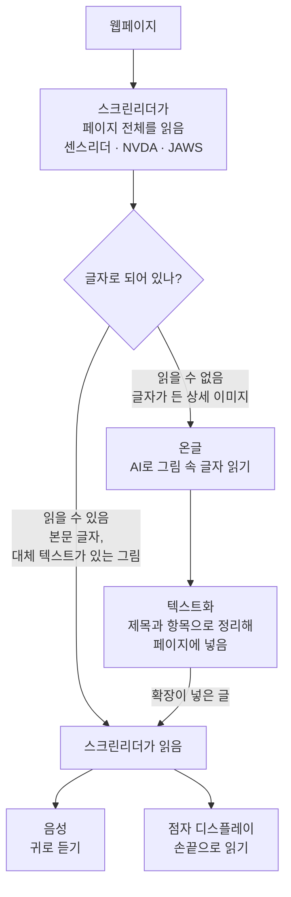

<p align="center"></p>

# 온글
그림 속 글자와 긴 페이지를 스크린리더가 읽을 수 있는 글로 바꿔 주는 확장 프로그램

온글은 "온전한 글"이라는 뜻입니다. 프로젝트(저장소) 이름은 SSUcreamMaker(숭실대에서 스크린리더 도구를 만든다는 뜻)이고, 사용자에게 보이는 확장 이름이 온글입니다.

쇼핑몰 상세페이지의 이미지 속 글자를 AI로 읽어 스크린리더가 읽을 수 있는 텍스트로 페이지에 넣고, 긴 페이지를 요약하거나 페이지 내용으로 질문에 답해 주는 크로미움 확장 프로그램입니다. 읽기는 평소 쓰는 스크린리더(센스리더, NVDA, JAWS)가 그대로 합니다. 점자 디스플레이만으로도 쓸 수 있게 결과와 오류를 페이지 안에 남깁니다.

기획과 진행 단계는 [docs/PROPOSAL.md](docs/PROPOSAL.md)를 참고하세요.

## 스크린리더 사용자는 웹을 어떻게 쓰나요?


시각장애인은 화면을 보는 대신 **스크린리더**(센스리더, NVDA, JAWS 등)를 씁니다. 스크린리더는 웹페이지의 글자와 구조(제목, 링크, 버튼, 표)를 읽어 두 가지로 전해 줍니다.

- **음성**: 글자를 소리로 읽어 줍니다. 마우스 대신 키보드로 제목, 링크, 표 단위로 건너뛰며 원하는 곳을 찾습니다.
- **점자 디스플레이**: 키보드 앞에 두는 기기입니다. 작은 핀이 올라와 점자를 만들고, 한 줄(보통 40칸 안팎)씩 손끝으로 읽습니다. 다 읽으면 버튼으로 다음 줄로 넘깁니다.


**시청각장애인**(보는 것과 듣는 것이 모두 어려운 사람)에게는 음성이 들리지 않으므로 점자 디스플레이가 웹을 읽는 유일한 통로입니다. 그래서 이 확장은 잠깐 소리로 알리고 사라지는 안내 대신, 결과와 오류를 페이지 안에 글로 남겨 점자로 언제든 다시 읽을 수 있게 합니다.

> 위 두 그림은 이해를 돕기 위해 AI(Codex)로 만든 예시입니다. 실제 기기의 모양과 점자 무늬는 다를 수 있습니다.

### 스크린리더가 읽지 못하는 것

스크린리더는 **글자만** 읽을 수 있습니다. 쇼핑몰 상세페이지처럼 가격, 옵션, 주의사항을 그림 속 글자로 넣고 대체 텍스트(그림 설명)를 달지 않으면, 스크린리더는 "그래픽"이라고만 읽거나 아예 건너뜁니다. 이 확장은 그 그림 속 글자를 AI로 읽어 스크린리더가 읽을 수 있는 글로 페이지에 넣어 줍니다.



음성과 점자로 내보내는 것은 사용자가 원래 쓰던 스크린리더입니다. 확장은 읽을 수 없던 부분을 글로 바꿔 페이지에 넣기만 하므로, 사용자는 익숙한 스크린리더 조작 그대로 그 내용을 읽습니다.

| 같은 상세 이미지에서 | 스크린리더가 읽는 것 |
|---|---|
| 확장 사용 전 | "그래픽" (또는 아무것도 읽지 않음) |
| 확장 사용 후 (`Alt+Shift+D`) | 예: "상세 이미지 내용, AI 추출, 제목 2" → "가격·할인, 제목 3" → "할인가 24,900원 (22% 할인)" … (평가용 쇼핑몰 기준, 문장은 AI 결과에 따라 다름) |

### 참고 영상

시청각장애인이 점자정보단말기(점자 디스플레이)로 실제로 소통하는 모습을 볼 수 있는 영상입니다.

| 영상 | 내용 |
|---|---|
| [](https://www.youtube.com/watch?v=jExIQsDwt_s) | [[이런뉴스] "빛도, 소리도 차단된 사람들" 시청각장애인을 아십니까](https://www.youtube.com/watch?v=jExIQsDwt_s)<br/>KBS News, 2025년 6월, 6분 52초<br/>국회에서 시청각장애인이 점자정보단말기를 손으로 읽으며 발언하고, 다른 시청각장애인들은 손을 맞잡는 촉수화로 내용을 전달받음 |
| [](https://www.youtube.com/watch?v=IRJ4dteEp40) | [[CBS 뉴스] '점자정보 단말기'…높은 가격에 고통 받는 시청각장애인들](https://www.youtube.com/watch?v=IRJ4dteEp40)<br/>CBS크리스천노컷뉴스, 2021년 10월, 3분 27초<br/>시청각장애인이 점자정보단말기로 카카오톡을 주고받고 뉴스를 보는 모습과 기기 가격 부담 문제 |
| [](https://www.youtube.com/watch?v=f1RQcWaw7Zg) | [Meet The First Deaf-Blind Harvard Law Grad, Haben Girma](https://www.youtube.com/watch?v=f1RQcWaw7Zg) (영어)<br/>Oxygen, 2016년 10월, 4분 37초<br/>하버드 로스쿨 첫 시청각장애인 졸업생의 일상. 상대가 키보드로 치면 점자 디스플레이로 읽고 말로 답하는 장면 |

## 설치

1. [Releases](https://github.com/SSUmart/SSUcreamMaker/releases)에서 `ongeul-v<버전>.zip` (26.1.0까지는 `ssucreammaker-v<버전>.zip`)을 받아 압축 풀기 (소스로 설치할 때는 저장소의 `extension` 폴더)
2. Chrome, Edge, Whale에서 `chrome://extensions` 열기 (Edge는 `edge://extensions`)
3. 개발자 모드 켜기
4. "압축해제된 확장 프로그램을 로드합니다"에서 압축을 푼 폴더 선택
5. 설치되면 설정 화면이 자동으로 열립니다.

새 버전으로 바꿀 때는 기존 폴더를 새 버전 파일로 덮어쓴 뒤 `chrome://extensions`에서 새로고침하면 설정(API 키 포함)이 유지됩니다. 다른 폴더에 풀어 로드하거나 확장을 삭제하고 다시 설치하면 새 확장으로 인식되어 설정이 지워집니다.

## 설정

1. "AI 기능 켜기" 체크
2. AI 공급자 선택
   - Google Gemini: [Google AI Studio](https://aistudio.google.com/)에서 API 키 발급
   - NVIDIA NIM: [build.nvidia.com](https://build.nvidia.com/)에서 API 키 발급. NIM은 기본 모델이 없으니 "모델" 목록에서 추천 후보를 고르거나 "직접 입력"으로 모델 이름을 넣습니다. 직접 설치한 NIM을 쓰면 API 주소 변경. NVIDIA 무료 키는 개발·테스트 용도로만 쓸 수 있습니다.
3. API 키 입력 후 "저장", "연결 확인"으로 키 확인

- API 키는 이 브라우저에만 저장되며 동기화되지 않습니다.
- AI를 켜면 단축키를 누를 때(항목 설명 모드에서는 항목을 클릭할 때) 상세 이미지, 페이지 글, 고른 항목의 글자·그림이 선택한 AI 서비스로 전송되고, 요금은 입력한 키의 계정에 청구됩니다. 입력창에 적은 내용과 링크 주소의 쿼리는 보내지 않습니다.
- Gemini 무료 등급은 보낸 내용이 Google의 서비스 개선에 쓰일 수 있으니 개인정보가 있는 페이지에서는 쓰지 마세요.

## 사용

| 단축키 | 기능 | 결과 |
|---|---|---|
| `Alt+Shift+D` (또는 툴바 아이콘) | 상세 이미지 읽기 | 첫 상세 이미지 앞에 "상세 이미지 내용, AI 추출" 제목이 생기고 그 위치로 이동. 가격·할인, 옵션·구성, 주의사항 같은 소제목(h3)으로 이동하며 읽음 |
| `Alt+Shift+S` | 페이지 요약 | 페이지 맨 위에 "페이지 요약, AI 생성" 상자가 생기고 그 제목으로 이동. 항목마다 "원문으로 이동" 버튼으로 근거 위치(닫힌 탭이면 탭을 열고)로 이동. "요약 닫기"로 원래 위치로 돌아감 |
| `Alt+Shift+Q` | 페이지에 질문하기 | 질문 대화상자가 열림. 질문을 쓰고 Enter를 누르면 답 문단으로 이동. 페이지에 답이 없으면 "페이지에서 찾지 못했습니다". "근거 위치로 이동"으로 근거를 확인. `Esc`로 닫으면 원래 위치로 돌아가고, 다시 열면 기록이 남아 있음 |
| `Alt+Shift+E` | 항목 설명 모드 (시험) | 켜면 화면 오른쪽 아래에 "항목 설명 모드" 표시가 생김. 이 상태에서 페이지 항목을 클릭하면(스크린리더에서는 Enter) 링크 이동·버튼 동작 대신 "항목 설명" 대화상자가 열리고 AI 설명 문단으로 이동. 이미지나 그림만 있는 버튼은 그림 속 글자까지 읽어 설명. `Esc`로 대화상자를 닫으면 고른 항목으로 돌아감. 모드는 `Esc`(대화상자가 닫힌 상태), `Alt+Shift+E`, "항목 설명 모드 끄기" 버튼으로 끔 |

- 상세 이미지를 먼저 읽으면(`Alt+Shift+D`) 그 내용도 요약과 질문 응답에 포함됩니다.
- 진행 중에는 "요약하는 중", "답을 찾는 중" 문장이 페이지에 남아 있어 점자로 다시 확인할 수 있습니다.
- 같은 페이지·같은 질문은 브라우저를 닫기 전까지 저장해 두어 AI를 다시 부르지 않습니다.

단축키는 `chrome://extensions/shortcuts`에서 바꿀 수 있습니다.

## 개발

```bash
npm test   # 단위 테스트 (Node 20 이상, 의존성 없음)
```

Gemini·NVIDIA NIM 추출 품질 비교와, API 키 없이 요약·질문 응답 흐름을 실제 브라우저에서 확인하는 E2E 점검(`npm run e2e`)은 [eval/README.md](eval/README.md)를 참고하세요.

확장 코드를 고친 뒤에는 `chrome://extensions`에서 새로고침하세요.

브랜치·커밋·버전·CHANGELOG 규칙은 [협업 규칙](.claude/skills/collab-rules/SKILL.md)을 따릅니다. 변경 내역은 [CHANGELOG.md](CHANGELOG.md)에 기록합니다.
